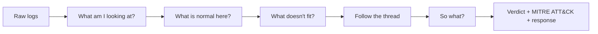

  

<h1 align="center">Journal</h1>

  <i>My cybersecurity notebook: what I learn, what I practice, and what finally clicks.</i>
    
  <a href="https://aparnaa19.github.io/journal/"><b>Open the journal →</b></a>

---

Every entry here is a real investigation on real attack data. I don't just record the answer.
I write down how I got there, including the wrong turns, because that's where the learning is.

## How I investigate

## Explore by area

| | |
|---|---|
| **[SIEM](content/siem)** | Hunting attacks in logs and turning them into searches |
| **[Sigma Rules](content/sigma-rules)** | Detection rules that work across SIEM platforms |
| **[Endpoint](content/endpoint)** | Persistence, execution and what attackers leave on a machine |
| **[Identity & Account](content/identity-account)** | Login abuse and account-based attacks |
| **[Network Security](content/network-security)** | Scans, traffic and packet-level investigation |
| **[Threat Intelligence](content/threat-intelligence)** | Phishing, real-world vulnerabilities and IOCs |
| **[Homelab](content/homelab)** | The labs I built to do this work |

## Toolkit

`Splunk` `Elastic Security` `Microsoft Sentinel` `Wazuh` `Sigma` `Sysmon`
`Windows Event Logs` `Wireshark` `VirusTotal` `MITRE ATT&CK`

---

  Built and maintained by <a href="https://github.com/aparnaa19">Aparnaa</a>

